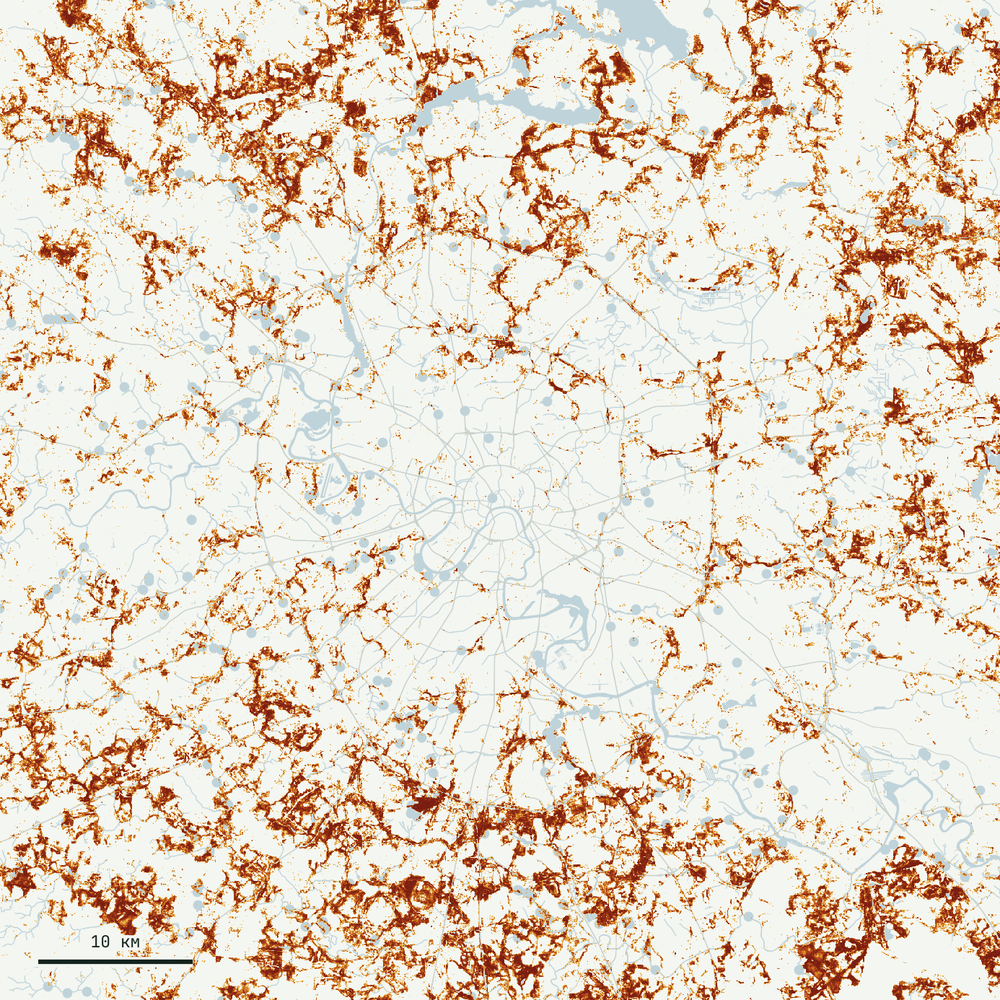
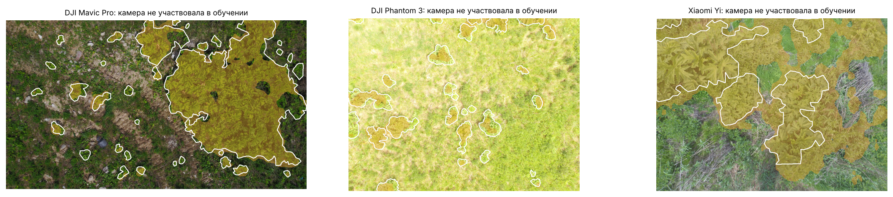

<p align="center">
  <a href="https://konkovdv.github.io/InvaRadar/"></a>
  <a href="presentation/InvaRadar_Ecopremia2026_podacha.pdf"></a>
  <a href="presentation/InvaRadar_Ecopremia2026.pdf"></a>
</p>

<p align="center">
  <a href="https://github.com/KonkovDV/InvaRadar/actions/workflows/ci.yml"></a>
  
  
  <a href="LICENSE"></a>
  <a href="LICENSE-DATA.md"></a>
</p>

# InvaRadar

Language: **EN** · [RU](README.md)

InvaRadar finds Sosnowsky's hogweed and two invasive goldenrods from satellite embeddings and turns the map into a crew work order: where a likely stand is, which control method the law allows there, and in which order to drive. A repeat image 3–4 weeks later checks the work and becomes next season's label.

A person signs the work order. The map narrows the search. It does not write a penalty notice.

Prepared for the Moscow Ecology Award 2026, category "Digitalisation of environmental solutions". Konkov D. V. ([@KonkovDV](https://github.com/KonkovDV)). Map: [konkovdv.github.io/InvaRadar](https://konkovdv.github.io/InvaRadar/).



## Contents

- [Where to look](#where-to-look)
- [What is already measured](#what-is-already-measured)
- [How it is built](#how-it-is-built)
- [What version 1.2 does not contain](#what-version-12-does-not-contain)
- [Run](#run)
- [Map and slides](#map-and-slides)
- [Documents](#documents)

## Where to look

1. Map of the 3,000 highest-priority stands of each species, with the method and the legal basis on click: [konkovdv.github.io/InvaRadar](https://konkovdv.github.io/InvaRadar/).
2. Numbers and the test protocol: [model card](docs/MODEL_CARD.md), [experiment log](docs/EXPERIMENTS.md).
3. The law inside a work order: [science note](docs/SCIENCE.md) and `invaradar/management.py`.
4. Award submission, 10 landscape A4 pages: [`presentation/InvaRadar_Ecopremia2026_podacha.pdf`](presentation/InvaRadar_Ecopremia2026_podacha.pdf). Full 27-slide talk: [`InvaRadar_Ecopremia2026.pdf`](presentation/InvaRadar_Ecopremia2026.pdf).

## What is already measured

A 65 × 65 km window, 4,225 km², 10 m cells, 42.25 million pixels. It covers Moscow and the inner belt of Moscow Oblast. The far parts of New Moscow (TiNAO) fall outside the window. Files: `outputs/heracleum/`, `outputs/solidago/`.

| | Hogweed | Goldenrod |
|---|---|---|
| Known reports inside the top 10% of area, on 5 km blocks held out of training | **25.0%** (95% CI 20.7–28.8), 2.5× a random search | **32.5%** (28.4–35.9), 3.3× |
| Known reports inside the top 1% of area | 2.5% (1.3–3.7) | **7.1%** (5.1–8.8), lift 7.1 (5.1–8.8) |
| New 2025–26 reports inside the top 20%, model trained through 2024 | 38.4% (33.7–43.3), n = 383 | 45.7% (40.5–50.9), n = 346 |
| ROC AUC against background, same blocks | 0.686 | 0.690 |
| Likely stands of at least 400 m² / within 300 m of schools, kindergartens and playgrounds | 16,056 / 4,309 | 22,252 / 6,995 |
| Drone spraying allowed / ground spot treatment / mechanical only | 168 / 10,367 / 5,521 | 171 / 14,675 / 7,406 |

Spatial intervals are a cluster bootstrap over 5 km blocks, 2,000 replicates. The forward-in-time intervals are Wilson scores. A random crew finds a share of reports equal to the share of area it walks: 10% of the area holds 10% of the reports.

The labels are citizen points with up to 50 m of coordinate error, often a plant smaller than the pixel. The working measure is therefore how many known points fall in the top of the map, not the outline of a stand. A ROC AUC near 0.69 is what that label noise looks like.

Citizen photos against look-alikes, 13,000 images, test observers absent from training: hogweed precision 86.7% at recall 86.5%; goldenrod 88.7% and 88.7%. At confidence 0.9 and above the model closes 68.2% of reports itself, and 93.8% of those calls name the right species. The rest go to a botanist.

UAV module, 263 aerial photos from the Moscow region in the open Skoltech set, three cameras, the test camera kept out of training: ROC AUC 0.948. At the scouting threshold (max F2, fit on the other cameras) Dice is 0.71, hogweed is present on 216 of 251 frames, and individual stands are found 60% of the time. The area threshold, max F1, gives Dice 0.66. Detail: [experiment log](docs/EXPERIMENTS.md), `make drone`.



Hogweed points reported by two or more observers fall in the top 10% of area 39.8% of the time (n = 133). That slice is `outputs/heracleum/exp_labels.json`. It does not replace the 25.0% row above.

## How it is built

1. **Satellite.** AlphaEarth Foundations embeddings of the 10 m cell and the mean in windows of 50, 150 and 450 m; log distance to roads, railways, water and power lines; terrain via Priority-Flood, D8 flow, TWI and HAND. 265 features. LightGBM, with background drawn from other plants recorded by the same observers (Phillips et al. 2009).
2. **Test.** 5 × 5 km blocks (Roberts et al. 2017) and a forward-in-time split. Area of applicability follows Meyer & Pebesma 2021: 96.3% of the window for hogweed, 95.7% for goldenrod. A 250-point field sample is stratified by likelihood (Olofsson et al. 2014).
3. **Queue.** Likelihood × proximity to people × proximity to roads, rivers and power lines × stand size.
4. **Work order.** Water Code art. 65: a 50, 100 or 200 m zone by river length, and no pesticides inside it. Sanitary rules СанПиН 2.1.3684-21: ground treatment only inside a settlement, a pesticide drone no closer than 700 m to housing, water and protected areas, and no pesticides on the grounds of a school or kindergarten. Federal law 73-ФЗ: no digging beside a heritage site. Protected areas and parks: mechanical methods. One hundred metres from a school, kindergarten or playground is a caution of this system. There is no statute that sets that distance.
5. **Check.** A repeat image after 3–4 weeks.

Terrain stays on for hogweed and is off for goldenrod. The rule was fixed in advance: the share of new reports inside the top 20% of area. Hogweed rose from 36.0% to 38.4%. Goldenrod fell from 45.7% to 43.4%. The plant keeps to damp verges, abandoned fields and banks. It is not a narrow floodplain specialist, and terrain is 3.4% of feature importance.

Rust inference matches LightGBM. The largest absolute difference is 8.9×10⁻¹⁶. The window takes about 2 minutes on 4 cores.

Hogweed labels from iNaturalist are *H. sosnowskyi*, *H. mantegazzianum*, and the giant-hogweed complex. In European Russia the last two taxa are usually the same Sosnowsky's hogweed filed under another name. The goldenrods are *S. canadensis* and *S. gigantea*. Both grow in the city.

Diagram and file list: [architecture](docs/ARCHITECTURE.md).

## What version 1.2 does not contain

- A register of confirmed stands. A hotspot is a connected patch of the top 2% of likelihood, at least 400 m². It is a queue for a visit.
- A completed walk of the 250 field points. The points are drawn. Ground area is not in the tables.
- Water-protection zones from the State Water Register. River length is measured on the network inside the window, a lower bound. The queues and the web map were built on 30 October 2026, before the confluence walk was corrected. The next pass on a fresh network is `make requeue`.
- A flight over Moscow. The 263 frames are the open Skoltech set, not a city orthomosaic.
- The wall-to-wall 10 m maps in git. `make release` writes them to `dist/release/` with GeoParquet and `SHA256SUMS`.

## Run

Python 3.11+ and Rust. A full run downloads about 9 GB: AlphaEarth blocks, iNaturalist, Overture, Copernicus DEM.

```bash
git clone https://github.com/KonkovDV/InvaRadar && cd InvaRadar
pip install -e ".[dev]"
make core test    # 6 Rust tests and 28 Python tests; 12 of the Python tests check the law on the published work orders and the map
make all          # both species, terrain variants, intervals, figures
```

On Windows, without make: `cargo test --release` inside `core-rs`, then `py -m pytest` at the root. The binary is `invaradar_core.exe`.

Data directories are `INVARADAR_DATA`, `INVARADAR_CACHE` and `INVARADAR_OUT`. After a change to the rules or the context layers, work orders are rebuilt without retraining: `make requeue`.

Docker: `docker build -t invaradar .`

## Map and slides

`web/index.html` is published by `.github/workflows/pages.yml`. `python scripts/export_web.py` refreshes the map data.

| File | Use |
|---|---|
| [`presentation/InvaRadar_Ecopremia2026_podacha.pdf`](presentation/InvaRadar_Ecopremia2026_podacha.pdf) | submission: 10 A4 pages in the sections the contest rules ask for |
| [`presentation/InvaRadar_Ecopremia2026.pdf`](presentation/InvaRadar_Ecopremia2026.pdf) | 27 slides, 16:9, for the talk and the questions |
| [`presentation/SPEAKER_NOTES.md`](presentation/SPEAKER_NOTES.md) | spoken text for the long deck |

Names and contacts for the title page live in `presentation/team.json`. `make deck` rebuilds both decks from `outputs/*.json`.

## Documents

| | |
|---|---|
| [Science](docs/SCIENCE.md) | species biology, the pixel, the statutes |
| [Experiments](docs/EXPERIMENTS.md) | what was kept, what was dropped, with the numbers |
| [Model card](docs/MODEL_CARD.md) | features, tests, limits |
| [Data card](docs/DATA_CARD.md) | hotspot fields, licences, how to read the raster |
| [Landscape](docs/LANDSCAPE.md) | open code and work from 2025–2026 |
| [Plan](docs/PLAN.md) | the 2027 season |
| [Sources](docs/SOURCES.md) | the reference list |

Code is Apache-2.0. Results are CC BY 4.0. Cite [CITATION.cff](CITATION.cff). "The AlphaEarth Foundations Satellite Embedding dataset is produced by Google and Google DeepMind." Observations © their iNaturalist authors. © OpenStreetMap contributors, Overture Maps Foundation. Copernicus DEM © DLR e.V., Airbus.
