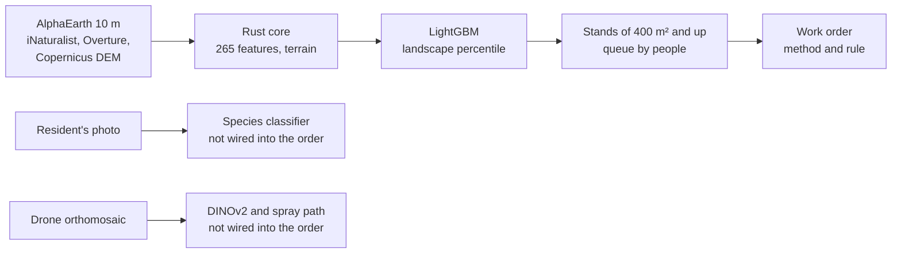

<p align="center">
  <a href="https://konkovdv.github.io/InvaRadar/"></a>
  <a href="https://github.com/KonkovDV/InvaRadar/blob/main/presentation/invaradar_video.mp4"></a>
  <a href="presentation/InvaRadar_Ecopremia2026_10.pdf"></a>
  <a href="presentation/InvaRadar_Ecopremia2026.pdf"></a>
</p>

<p align="center">
  <a href="https://github.com/KonkovDV/InvaRadar/actions/workflows/ci.yml"></a>
  
  
  <a href="LICENSE"></a>
  <a href="LICENSE-DATA.md"></a>
  
</p>

[Русский](README.md) | English

# InvaRadar

**The problem.** Since 1 March 2026, federal law 294-ФЗ requires land holders to control dangerous invasive plants. Regions set the lists. For Moscow that list is city government resolution 369-ПП of 3 March 2026: group I includes Sosnowsky's hogweed and the Canadian and giant goldenrods ([GARANT](https://base.garant.ru/413816164/)). The fine under art. 8.7 part 2 of the federal code is 20–50 thousand roubles for a person and 400–700 thousand for a company. Moscow also has art. 4.17 part 4 of the city code; those amounts still need the official text. Drone launches over the city have been restricted since May 2023.

**What InvaRadar does.** From open satellite embeddings it computes a 10 m map of relative risk (a landscape percentile) for Sosnowsky's hogweed and two goldenrods. About the top 2.2% of area, after the rank is stored in 250 levels, in patches of at least 400 m², goes into a queue for a visit. For each candidate it drafts a work order: which methods are allowed if the species is confirmed on site. The work order stays a draft until an inspector signs it.

| Link | Question | InvaRadar |
|---|---|---|
| Satellite | where the landscape rank is higher | a map of both species over 4,225 km² at 10 m |
| Queue | where should the crew go first | rank × proximity to people × proximity to roads, rivers and power lines × size; a straight-line order, not a road route |
| Check | is it hogweed or wild angelica | a resident's photo → species classifier; a drone orthomosaic → stand outline |
| **Work order** | **which method is lawful here** | **method and rule: Water Code art. 65, sanitary rules СанПиН 2.1.3684-21, heritage law 73-ФЗ** |
| Follow-up | did it work | a revisit date in the order; the image after the work closes the loop in the 2027 season |

Prepared for the Moscow Ecology Award 2026, category "Digitalisation of environmental solutions". Dmitrij V. Konkov leads the work (ML and remote sensing, [@KonkovDV](https://github.com/KonkovDV)). Elena Yu. Konkova does the geoinformatics and the Rust core.

## What already works

- **A map of both species** over a 65 × 65 km window: Moscow and the inner belt of Moscow Oblast, 42.25 million pixels. Once the embedding mosaic is cached, the Rust core scores every pixel in tens of seconds.
- **Tested on 5 km blocks.** A checkerboard, plus a 500 m ring around each test presence, wider than the 450 m feature window. The top 10% of area holds 23.3% of known hogweed reports (95% CI 19.3–26.8) and 32.5% of goldenrod (27.8–36.3). The Boyce index, 1.000 and 0.988, only says the rank bins are nearly ordered. The slope is the predicted-to-expected ratio: 2.33 and 3.25 in the top tenth of area, 0.24 and 0.17 in the bottom tenth.
- **Tested on later reports.** A 2025–2026 report counts as new only when it is more than 500 m from a report through 2024. The check uses places more than 500 m from a report through 2024: 216 of 504 hogweed reports and 188 of 446 goldenrod reports. Of those, 34.7% and 41.5% fall in the top 20% of area. Both sides use the 2025 AlphaEarth embeddings. The shares are computed on points held out of that fold.
- **A draft order for each of 36,068 candidates for a visit** (16,352 hogweed and 19,716 goldenrod). The threshold is percentile 0.98; after 250 levels that is about 2.2% of area, and patches under 400 m² are dropped. Hogweed candidates cover 9,322.9 ha. The species is confirmed on site.
- **The law is checked by tests** on the top 200 orders of each species and on every point of the web map: no chemicals in a water-protection zone, a protected area or next to children; no pesticide drone inside a settlement; no digging beside a heritage site.
- **Residents' photos.** Hogweed against wild angelica, Siberian hogweed, cow parsley and ground elder: precision 86.7%, recall 86.5%. Goldenrod against tansy, ragwort and St John's wort: 88.7% and 88.7%. At confidence 0.9 and above the model closes 68.2% of reports itself; 6.2% of those are wrong.
- **The drone module on 263 aerial photos** of the Moscow region: ROC AUC 0.948 on 14 × 14 patches when the capturing camera was kept out of training. The authors of that set report 0.96 under a different protocol (Menshchikov et al., 2021). The frames are not in this repository.
- **Rust inference matches LightGBM**: the largest difference is 1.1×10⁻¹⁵ for hogweed and 8.9×10⁻¹⁶ for goldenrod on 2,000 pipeline points (`rust_parity_max_abs_diff`). The single-node NaN test does not measure that number.


<sub>Landscape percentile, 2025. The dark patches are the top percentiles of area, where a visit goes first.</sub>

## Contents

- [Where to start](#where-to-start)
- [Numbers](#numbers)
- [How it is built](#how-it-is-built)
- [The law in a work order](#the-law-in-a-work-order)
- [Where the choices come from](#where-the-choices-come-from)
- [Related work](#related-work)
- [Limits of version 1.2](#limits-of-version-12)
- [Hard questions](#hard-questions)
- [Run](#run)
- [Layout and stack](#layout-and-stack)
- [Documents](#documents)
- [Citation and licences](#citation-and-licences)

## Where to start

The 3,000 highest-priority stands of each species, with the method and the rule on click: [konkovdv.github.io/InvaRadar](https://konkovdv.github.io/InvaRadar/).

Project video: [github.com/KonkovDV/InvaRadar/blob/main/presentation/invaradar_video.mp4](https://github.com/KonkovDV/InvaRadar/blob/main/presentation/invaradar_video.mp4).

[](https://konkovdv.github.io/InvaRadar/)

<sub>Rust: mechanical only. Amber: ground spot treatment. Blue: drone spraying allowed. Basemap © OpenStreetMap contributors. The interface is in Russian.</sub>

| You are | Read |
|---|---|
| A jury member | the [project video](https://github.com/KonkovDV/InvaRadar/blob/main/presentation/invaradar_video.mp4), the [submission deck](presentation/InvaRadar_Ecopremia2026_10.pdf), the map, then "Numbers" and "Limits" below |
| A botanist or ecologist | the [science note](docs/SCIENCE.md), the [model card](docs/MODEL_CARD.md), the [experiment log](docs/EXPERIMENTS.md) (in Russian) |
| A lawyer or inspector | [the law section](docs/SCIENCE.md#7-право), `invaradar/management.py`, `tests/test_legal_invariants.py` |
| A GIS specialist | the [data card](docs/DATA_CARD.md), the `stac/` catalogue, `make release` |
| A developer | the [architecture](docs/ARCHITECTURE.md), [contributing](CONTRIBUTING.md), the `Makefile` |

## Numbers

A 65 × 65 km window, 4,225 km², 10 m cells. It covers Moscow and the inner belt of the oblast; the far parts of New Moscow fall outside. Every number is in `outputs/heracleum/`, `outputs/solidago/`, `outputs/photo/` and `outputs/drone/`.

| | Hogweed | Goldenrod |
|---|---|---|
| Reports in the top 10% of area, on 5 km blocks held out of training | **23.3%** (95% CI 19.3–26.8), 2.3× a random search | **32.5%** (27.8–36.3), 3.3× |
| Reports in the top 1% of area | 1.3% (0.6–2.1); the lift interval includes 1 | **7.6%** (4.8–10.2), 7.6× |
| New 2025–26 places farther than 500 m, top 20%, trained through 2024 | 34.7% (28.7–41.3), 216 of 504 | 41.5% (34.7–48.6), 188 of 446 |
| ROC AUC against background, same blocks | 0.687 | 0.684 |
| Boyce index, reports against rank | 1.000 | 0.988 |
| Share of area inside the model's area of applicability | 97.2% | 96.4% |
| Likely stands of at least 400 m² / within 300 m of schools, kindergartens and playgrounds | 16,352 / 4,188 | 19,716 / 6,045 |
| Drone spraying / ground treatment / mechanical only | 170 / 10,262 / 5,920 | 149 / 12,721 / 6,846 |

Intervals are a bootstrap over 5 km blocks, 2,000 replicates, and a Wilson interval for the year split. A random search finds a share of reports equal to the share of area it covers.

The labels are residents' points with up to 50 m of coordinate error, often a plant smaller than the pixel. The measure is the share of known points in the upper part of the map. Hogweed points with a second research-grade observer within 30 m fall in the top 10% of area 39.1% of the time (n = 133), from a separate run in `scripts/exp_labels.py` (3 folds, 150 trees, the same L2 penalty as the map). The deployed model uses 5 folds and 300 trees. The figure is in `outputs/heracleum/exp_labels.json`.

Drone module, 263 aerial photos: the probe does not train on the camera that took the frame. At the scouting setting Dice is 0.71 and hogweed is found on 216 of 251 frames. For area counts the max F1 setting gives Dice 0.66. Per-camera numbers are in the [experiment log](docs/EXPERIMENTS.md). The frames are not in this repository.

## How it is built



1. **Features.** 64 dimensions of the AlphaEarth Foundations embedding at the 10 m cell and the means in windows of 50, 150 and 450 m. Log distance to major roads, minor roads, railways, water and power lines. Terrain: Priority-Flood depression filling, D8 flow, TWI and HAND. 265 features in all.
2. **Model.** LightGBM, a report against background. The background is 60,000 records of other vascular plants by any observer in the same window. That reduces the pull toward roads and parks. It does not remove it.
3. **Test.** A checkerboard of 5 × 5 km blocks and a 500 m ring around test presences, wider than the 450 m window. A second split uses label year on the single 2025 image, with the same 500 m ring, as above. Area of applicability after Meyer & Pebesma. A 250-point field sample over four rank strata is laid out for the 2027 pilot. The shares in `outputs/` are the 6 November 2026 run.
4. **Queue.** Connected patches of about the top 2.2% of area after the rank is stored in 250 levels, 400 m² and up. Three ranks are separate columns: near children area does not count, containment prefers a small isolated stand, stands of 1 ha and more are a separate programme. The straight line through the first points follows `priority`, which still includes area. There is no road network.
5. **Work order.** The rules in `invaradar/management.py`, each with its own legal basis. The order stays a draft until an inspector signs it. Resolution 369-ПП is written only when a jurisdiction polygon is passed. The photo classifier and the UAV module do not write the order.

Terrain stays on for hogweed and is off for goldenrod. The rule was set before the comparison: the share of new reports in the top 20% of area. The share of new hogweed places in the top 20% of area rose from 30.6% to 34.7%. For goldenrod, terrain lowered it from 41.5% to 35.6%. Hogweed keeps to damp verges, abandoned fields and banks; on old fields goldenrod follows abandonment more than water.

Hogweed labels come from three iNaturalist taxa: *H. sosnowskyi*, *H. mantegazzianum* and the giant-hogweed complex. In central Russia the last two are almost always Sosnowsky's hogweed filed under another name. The goldenrods are *Solidago canadensis* and *S. gigantea*: both grow in the city, and crews remove both.

Module diagram and file list: [architecture](docs/ARCHITECTURE.md).

## The law in a work order

Versions as of 30 October 2026: the Water Code as amended on 4 August 2026; sanitary rules СанПиН 2.1.3684-21 with the amendments of 12 February 2026 (in force since 10 March 2026).

| Rule | Basis | Hogweed stands |
|---|---|---|
| Water-protection zone of 50, 100 or 200 m by river length: no pesticides, mechanical methods only | Water Code art. 65, parts 4–6 and part 15 items 3, 6 | 4,942 |
| Settlement: ground equipment only; a pesticide drone no closer than 700 m to housing, a water body with a statutory zone, and protected areas. A ditch is not that buffer | СанПиН 2.1.3684-21, items 273 and 282 | 10,262 treated from the ground |
| Grounds of a children's organisation: no pesticides | СанПиН 2.1.3684-21, item 273 | 92 |
| School, kindergarten or playground within 100 m: no pesticides; a separate safety rank, not the visit order | a caution of this system; no statute sets this distance | 1,138 |
| Protected areas and parks: mechanical methods | protected-area regimes, Mospriroda practice | 779 |
| Heritage site within 50 m: no digging | a caution of this system; art. 36 of 73-ФЗ requires clearance for earthworks, and the statute sets no 50 m distance | 79 |
| Ground chemical treatment: notice 5 days ahead and signs. Inside a settlement, also before 07:00 or after 22:00 | СанПиН 2.1.3684-21, items 272 and 273 | ground chemical orders, not mechanical ones |

Hogweed totals: mechanical only 5,920 stands, ground spot treatment 10,262, drone spraying allowed 170, all outside settlements. Goldenrod: 6,846, 12,721 and 149. A canal is not given a river-length width: Water Code art. 65 part 9 sets the width to the right-of-way, and this layer has none. Resolution 369-ПП is written only inside the Moscow polygon (`boundaries/jurisdictions.geojson`). In the top 200 that is 93 hogweed orders and 79 goldenrod orders. The other 107 and 121 fall in Moscow oblast: that list is not verified, so no duty is written.

Biology in the order: umbels are cut before the end of July and again in August, then destroyed, because seed ripens on a cut umbel. Soil from the stand is not hauled away, and machines and boots are cleaned on site. Stands larger than 0.5 ha are mown at least every two weeks from May through September. The root collar is cut 10–15 cm down, up to 20 cm on a large plant, where digging is not forbidden. A repeat visit is due in 3–4 weeks. Both hogweed and goldenrod are watched for 5 seasons. Hogweed orders name the protective equipment.

## Where the choices come from

| Observation | What InvaRadar does |
|---|---|
| Citizen records cluster along roads and in parks. Background from other plants in the same window reduces that bias. It does not remove it (Phillips et al., 2009) | background of 60,000 records of other plants by any observer |
| A random split overstates a spatial model (Roberts et al., 2017) | a checkerboard of 5 × 5 km blocks, a 500 m ring, and a separate split by label year |
| A map cannot be trusted where the features are far from training (Meyer & Pebesma, 2021) | a dissimilarity index against the full training set; 2.8% of the area is outside applicability for hogweed and 3.6% for goldenrod |
| Map area and accuracy are estimated from a stratified random sample (Olofsson et al., 2014) | 250 points over four rank strata; the walk is the 2027 pilot |
| Without filling depressions, flow stops in every pit (Barnes et al., 2014); HAND measures height above the stream along the flow path (Rennó et al., 2008) | Priority-Flood, D8, TWI and HAND in the Rust core |
| Open annual 10 m embeddings describe every pixel without labelling imagery (AlphaEarth Foundations, 2025) | 64 dimensions of the pixel and means in three windows |
| A frozen DINOv2 transfers to a new task with a linear probe (Oquab et al., 2024) | UAV library: a probe on the 14 × 14 patch and its 3 × 3 neighbourhood. It is not wired into the work order |
| A single plant is smaller than a Sentinel-2 pixel | the satellite narrows the search, the drone draws the outline |

Full reference list: [sources](docs/SOURCES.md).

## Related work

| Work | What it does | Number from an open source | Relation to InvaRadar |
|---|---|---|---|
| Skoltech, Menshchikov et al., 2021 | on-board hogweed segmentation on a drone, Jetson Nano | ROC AUC 0.96 | on their set the drone module reaches 0.948 with the frame's camera kept out of training |
| Yandex, School of Data Analysis and StopBorshchevik, 2026 | pixel CatBoost on RGB and the CIVE index, not a neural net | 421 ha in 17 regions; IoU 0.7 in the blog and 0.75 on Habr | labels inside expert polygons were partly made by the same CIVE threshold, so the IoU is high by construction. Moscow and the oblast are mapped in full: that would be an independent check, and it needs permission |
| Moscow Oblast agriculture ministry, 2026 | remote sensing, drone, cadastre, fine | first fine of 150 thousand roubles, Ruza district | the same chain, steered towards children first and a lawful method |
| Invasium, Tsitsin Main Botanical Garden | photos through a chat bot, checked by botanists | — | the classifier takes the confident reports off the botanist's desk |
| Hogweed SDM for Lithuania | habitat suitability | 1 km grid | 10 m cells and tests on new areas and years |

InvaRadar computes the map, the visit queue and a draft work order. The city environment department already has its own loop: an address list, remote-sensing data and cameras. InvaRadar complements that loop. It does not replace it. Open code and models from 2025–2026: [landscape](docs/LANDSCAPE.md) (in Russian).

## InvaRadar Pro

Pro is the layer after the map: the law inside the order, a human signature, proof of the work, five seasons of follow-up, and a corridor audit. Code, tests and documents are in [`pro/`](pro/README.md) (the documents are in Russian).

```bash
pip install -e ".[dev,pro]"
make pro-test    # 45 tests; they also run as part of make test
make pro-demo    # an offline walkthrough, written to pro/out_demo
```

## Limits of version 1.2

| Area | Now | Next |
|---|---|---|
| Field check | 250 points laid out over four rank strata | the walk in the 2027 pilot |
| Water-protection zones | river length inside the window is a lower bound; a ditch is a 50 m caution and is not the 700 m aerial buffer; queues and map are the 6 November 2026 run | boundaries from the State Water Register; rerun with `make requeue` |
| Protected areas | parks, natural monuments and reserves from Overture | the official protected-area layer |
| Drone | 263 spring frames from Skoltech: leaves and rosettes | summer flights over Moscow under a city contract, a bloom index |
| Follow-up | a revisit date in the order | an image after the work, feeding the next season's labels |
| Residents' photos | a separate module; its weights are not in the repository | an openly licensed model for a municipal deployment |
| Terrain | Copernicus DEM includes buildings and canopy | a city terrain model without buildings |
| Wall-to-wall 10 m maps | `make release` writes them to `dist/release/` | a GitHub release |

## Hard questions

| Question | Short answer | Detail |
|---|---|---|
| How to read the top 10% | It is the share of known points inside 10% of the area, on districts the model never saw: 2.3 times a random search for hogweed and 3.3 times for goldenrod | [model card](docs/MODEL_CARD.md) |
| What AUC shows | AUC measures how a report separates from background over the whole area. A crew uses the top of the queue, where reports are denser than in a random walk of the same area | [experiment log](docs/EXPERIMENTS.md) |
| Can a drone spray in Moscow? | Inside a settlement only ground equipment is allowed, and a pesticide drone must stay 700 m from housing, a water body with a statutory zone, and protected areas. A ditch is not that buffer. In this run that leaves 170 and 149 stands, all outside settlements | [law](docs/SCIENCE.md#7-право) |
| Does the AI issue fines? | No. The map is a risk indicator. The order is a draft with an empty signer field. An inspector writes any protocol under art. 8.7 | [model card](docs/MODEL_CARD.md) |
| Why terrain for hogweed only? | The rule was set before the comparison. Terrain raised the share of new hogweed reports and lowered it for goldenrod | [experiment log](docs/EXPERIMENTS.md) |
| Why is *H. mantegazzianum* in the hogweed labels? | In central Russia records under that name on iNaturalist are almost always Sosnowsky's hogweed. Dropping them would drop real stands | [model card](docs/MODEL_CARD.md) |
| What if AlphaEarth goes away? | Embeddings enter through one interface; TESSERA and OlmoEarth provide comparable global 10 m layers. Version 1.2 has not been run on them | [landscape](docs/LANDSCAPE.md) |
| Whose photos are these? | The slides use iNaturalist photos under CC BY and CC0, authors in `presentation/assets/CREDITS.csv`. `scripts/photo_dataset.py` keeps only CC0 and CC BY for a model a city can ship. The aerial set is used for evaluation only and is not redistributed | [NOTICE](NOTICE) |
| Personal data? | The model holds plant coordinates only. A bot or API must not keep faces, number plates or home geotags (152-ФЗ) | [security](SECURITY.md) |
| Why Rust? | 42 million pixels × 265 features in one pass. The first mosaic takes a few minutes; scoring the grid again takes tens of seconds. Terrain is cached | [architecture](docs/ARCHITECTURE.md) |

## Run

Python 3.11+ and Rust. A full run downloads about 9 GB of open data: AlphaEarth blocks, iNaturalist records, Overture, Copernicus DEM.

```bash
git clone https://github.com/KonkovDV/InvaRadar && cd InvaRadar
pip install -e ".[dev,pro]"
make core test    # 9 Rust tests and 117 Python tests: 16 check the law on the orders and the map, 45 are InvaRadar Pro
make all          # data, both species, terrain variants, intervals, figures
```

Without make, Windows included: `cargo test --release` inside `core-rs`, then `python -m pytest` at the root. On Windows the core binary is `invaradar_core.exe`.

| Command | What it does |
|---|---|
| `make requeue` | rebuilds queues, work orders and the web map after a change to rules or layers, without retraining |
| `make drone` | the drone benchmark on the Skoltech set (`pip install -e ".[drone]"`, the set cloned next to the repository) |
| `make release` | wall-to-wall 10 m maps (COG), stand GeoParquet, the STAC catalogue and `SHA256SUMS` in `dist/release/` |
| `make deck` | both decks from `outputs/*.json` |

Data directories are set by `INVARADAR_DATA`, `INVARADAR_CACHE` and `INVARADAR_OUT`. Docker: `docker build -t invaradar .`

## Layout and stack

```
core-rs/        Rust core: features, terrain, inference, stands, route, sampling
invaradar/      Python package: data, priority, legal rules, drone module
scripts/        pipeline, area of applicability, intervals, maps, photo classifier
tests/          the law on work orders, water zones, priority, dequantisation, drone, core
outputs/        metrics, intervals, queues, top 200 orders, field sample, figures
web/            web map on MapLibre GL
stac/           STAC 1.1 catalogue for the wall-to-wall maps
presentation/   decks, generators, fonts, photos
docs/           science, experiments, model and data cards, landscape, plan, sources
```

- **Rust 2024**: `rayon`, `memmap2`, `serde_json`, `anyhow`. One multithreaded pass over the mosaic, no copies.
- **Python**: LightGBM, scikit-learn, GeoPandas, Shapely, rasterio, pyproj, PyArrow. Drone module: PyTorch and timm (`.[drone]`). Photo classifier: Ultralytics (`.[photo]`).
- **Formats**: Cloud Optimized GeoTIFF, GeoParquet, STAC 1.1.
- **Web map**: MapLibre GL over OpenStreetMap, published with GitHub Pages.
- **CI**: `cargo fmt`, `clippy -D warnings`, `cargo test`, `ruff`, `pytest` on Python 3.11, 3.12 and 3.13.

## Documents

The documents below are in Russian.

| Document | Contents |
|---|---|
| [Science note](docs/SCIENCE.md) | species biology, the pixel, hydrology, law, heritage |
| [Experiment log](docs/EXPERIMENTS.md) | what was compared, by which rule, what was kept |
| [Model card](docs/MODEL_CARD.md) | features, training, tests, limits, ethics |
| [Data card](docs/DATA_CARD.md) | stand and order fields, files, provenance, reading the raster |
| [Architecture](docs/ARCHITECTURE.md) | diagram, modules, why Rust and Python |
| [Landscape](docs/LANDSCAPE.md) | work in Russia and abroad, open code, models of 2025–2026 |
| [Plan](docs/PLAN.md) | the 2027 season, KPIs, team, budget, risks |
| [Sources](docs/SOURCES.md) | literature, statutes, data |
| [Decks](presentation/README.md) | files, design, rebuilding |
| [Changelog](CHANGELOG.md) | versions 0.1 to 1.2 |

## Citation and licences

GitHub shows a "Cite this repository" button from [CITATION.cff](CITATION.cff).

```bibtex
@software{konkov_invaradar_2026,
  author  = {Konkov, Dmitrij V.},
  title   = {InvaRadar: early detection of invasive plants from satellite embeddings, drones and citizen photos},
  version = {1.2.0},
  year    = {2026},
  url     = {https://github.com/KonkovDV/InvaRadar},
  license = {Apache-2.0}
}
```

Code is [Apache-2.0](LICENSE). Maps, stands, work orders and metrics are [CC BY 4.0](LICENSE-DATA.md). "The AlphaEarth Foundations Satellite Embedding dataset is produced by Google and Google DeepMind." Observations © their iNaturalist authors. © OpenStreetMap contributors, Overture Maps Foundation. Copernicus DEM © DLR e.V., Airbus. Full list: [NOTICE](NOTICE).

How to help: [CONTRIBUTING.md](CONTRIBUTING.md). Vulnerabilities: [SECURITY.md](SECURITY.md).
