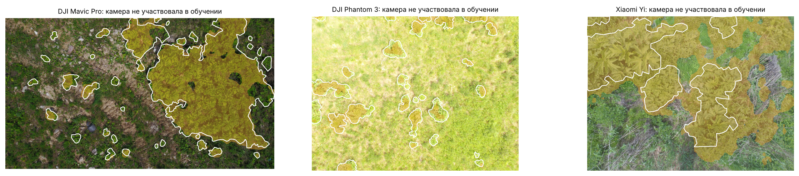

# ИнваРадар

[](https://github.com/KonkovDV/InvaRadar/actions/workflows/ci.yml)
[](LICENSE)
[](LICENSE-DATA.md)
[](pyproject.toml)
[](core-rs/Cargo.toml)

Репозиторий: [KonkovDV/InvaRadar](https://github.com/KonkovDV/InvaRadar). Карта: [konkovdv.github.io/InvaRadar](https://konkovdv.github.io/InvaRadar/). [English](README.en.md).

Если эта страница расходится с [ограничениями](docs/LIMITS.md) или с JSON в `outputs/`, верны ограничения и JSON. Откуда взято каждое число таблицы — [реестр утверждений](docs/CLAIMS.md).

ИнваРадар находит борщевик Сосновского и золотарники по спутниковым данным и превращает карту в наряд для бригады: где очаг, каким методом его можно уничтожать по закону и в каком порядке объезжать. После работ повторный снимок проверяет результат и становится разметкой следующего сезона.

Проект подготовлен к Экологической премии Москвы 2026, номинация «Цифровизация экологических решений». Автор репозитория — Коньков Д. В. ([@KonkovDV](https://github.com/KonkovDV)). Имена, телефон и ссылка на видео для титульного листа заявки живут в `presentation/team.json` и в репозиторий не подставлены.


## Результаты на реальных данных Москвы

| | Борщевик | Золотарник |
|---|---|---|
| Территория | 4 225 км², шаг 10 м, 42,25 млн пикселей | то же |
| Находки в верхних 10% площади на районах, которых модель не видела | **25,0%** (95% ДИ 20,7–28,8%), в 2,5 раза выше случайного обхода | **32,5%** (28,4–35,9%), в 3,3 раза |
| Находки в верхнем 1% площади | 2,5% | **7,1%**, в 7 раз |
| Новые находки 2025–2026 гг. в верхних 20% площади, модель обучена до 2024 г. | 38,4% (n = 383) | 45,7% (n = 346) |
| Очаги / из них в 300 м от школ, детских садов и площадок | 16 056 / 4 309 | 22 252 / 6 995 |
| Опрыскивание с дрона допустимо / наземная точечная обработка / только механика | 168 / 10 367 / 5 521 | 171 / 14 675 / 7 406 |

ИИ-проверка фото жителей против двойников: борщевик — точность 86,7% при полноте 86,5%, золотарник — 88,7% и 88,7%. При уверенности от 0,9 модель закрывает 68,2% сообщений сама, и среди этих ответов верны 93,8% (доля верных, не точность класса).

Модуль БПЛА на 263 реальных аэрофото Подмосковья (открытый набор Сколтеха, три камеры; камера проверки в обучении не участвует): ROC AUC 0,948. В режиме разведки, порог max F2 подобран только на других камерах, Dice 0,71 и борщевик найден на 216 из 251 снимков. На сбалансированном пороге max F1 Dice 0,66 — `make drone`, [журнал экспериментов](docs/EXPERIMENTS.md).



## Как это работает

1. **Спутник.** Эмбеддинги AlphaEarth Foundations, ландшафтный контекст 50–450 м, расстояния до дорог, рек и ЛЭП, гидрология рельефа (Priority-Flood, D8, TWI, HAND). LightGBM, проверка на блоках 5 км и «вперёд во времени».
2. **Очередь.** Вероятность × близость людей × близость коридоров распространения × размер очага.
3. **Проверка.** Модуль БПЛА обводит куртину по ортофотоплану: замороженный DINOv2 (Apache-2.0) и линейный классификатор, для цветущих куртин — индекс цветения, опционально фильтр по высоте; классификатор проверяет фото жителей.
4. **Наряд.** Метод работ по Водному кодексу (зоны 50/100/200 м по длине реки, внутри — никаких пестицидов), СанПиН 2.1.3684-21 (в населённых пунктах — только наземная обработка, беспилотник с пестицидом — не ближе 700 м от жилья, вод и ООПТ; запрет на территориях детских организаций), 73-ФЗ; ООПТ — механические методы.
5. **Контроль.** Повторный снимок через 3–4 недели; результат становится разметкой.

Подробно: [архитектура](docs/ARCHITECTURE.md), [научное обоснование](docs/SCIENCE.md), [журнал экспериментов](docs/EXPERIMENTS.md), [карточка модели](docs/MODEL_CARD.md), [карточка данных](docs/DATA_CARD.md), [аналоги и SOTA 2026](docs/LANDSCAPE.md), [план проекта](docs/PLAN.md), [источники](docs/SOURCES.md), [реестр утверждений](docs/CLAIMS.md), [границы](docs/LIMITS.md).

## Быстрый старт

```bash
git clone https://github.com/KonkovDV/InvaRadar && cd InvaRadar
pip install -e ".[dev]"            # или: uv pip install -e ".[dev]"
make core test                      # Rust-ядро, 6 тестов Rust и 28 тестов Python (12 — правовые инварианты нарядов)
make all                            # данные, обе модели, варианты, интервалы, рисунки
```

Сырые данные (около 9 ГБ: блоки AlphaEarth, наблюдения iNaturalist, Overture, ЦМР) скачиваются скриптами из открытых источников. Папки задаются переменными `INVARADAR_DATA`, `INVARADAR_CACHE` и `INVARADAR_OUT`; за прокси с подменой сертификатов укажите `HTTPS_PROXY` и `INVARADAR_CA_BUNDLE`.

После изменения правил, приоритета или слоёв очереди и наряды пересчитываются без переобучения модели: `make requeue` (нужны только Overture и готовые очаги). `make release` собирает сплошные карты 10 м (Cloud Optimized GeoTIFF), GeoParquet очагов, каталог STAC и `SHA256SUMS` в `dist/release/`. Эти файлы в git не входят. Docker: `docker build -t invaradar . && docker run -v $PWD/data:/work/data -v $PWD/cache:/work/cache invaradar`.

## Интерактивная карта

`web/index.html` — карта 3 000 приоритетных очагов каждого вида с методом работ и правовым основанием по клику, фильтром по методу и примером дневного маршрута. Workflow `.github/workflows/pages.yml` публикует её на [konkovdv.github.io/InvaRadar](https://konkovdv.github.io/InvaRadar/) (Settings → Pages → Source: GitHub Actions). Данные карты обновляет `python scripts/export_web.py`. Ролик 1:48 к заявке в git не хранится: публичная ссылка записывается в поле `video` файла `presentation/team.json`.

## Презентации

| Файл | Для чего |
|---|---|
| `presentation/InvaRadar_Ecopremia2026_podacha.pdf` | **для подачи на премию**: 10 страниц A4 по Положению о конкурсе (титульный лист, оглавление, введение, пять разделов основной части, заключение) |
| `presentation/InvaRadar_Ecopremia2026.pdf` | полная версия, 27 слайдов 16:9: выступление и приложение для вопросов экспертов |

Команда и контакты для титульного листа — в `presentation/team.json`; `make deck` пересобирает обе презентации из `outputs/*.json`.

## Структура

```
core-rs/        Rust-ядро: признаки, рельеф и гидрология, инференс, очаги, маршрут, выборка
invaradar/      Python-пакет: данные, приоритет, правила обработки, модуль БПЛА
scripts/        пайплайн, обогащение, интервалы, карты и рисунки, классификатор фото
tests/          тесты Python (правила, водоохранные зоны, правовые инварианты нарядов, приоритет, деквантование, БПЛА, ядро)
outputs/        метрики, интервалы, очереди, наряды, полевая выборка, рисунки
stac/           каталог STAC для ассетов релиза
presentation/   презентация PowerPoint и PDF, генератор, шрифты, ассеты
docs/           план, наука, журнал экспериментов, аналоги и SOTA, карточки модели и данных, источники
```

## Цитирование и лицензии

Код — Apache-2.0, результаты — CC BY 4.0, см. [CITATION.cff](CITATION.cff) и [NOTICE](NOTICE). «The AlphaEarth Foundations Satellite Embedding dataset is produced by Google and Google DeepMind.» Наблюдения © авторы iNaturalist; © участники OpenStreetMap, Overture Maps Foundation; Copernicus DEM © DLR e.V., Airbus.
