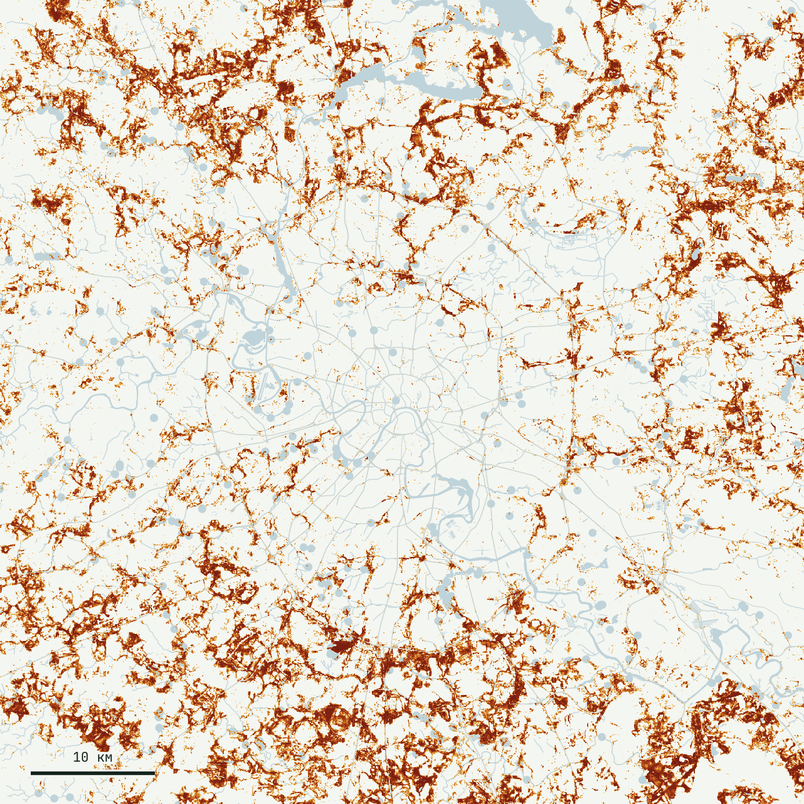
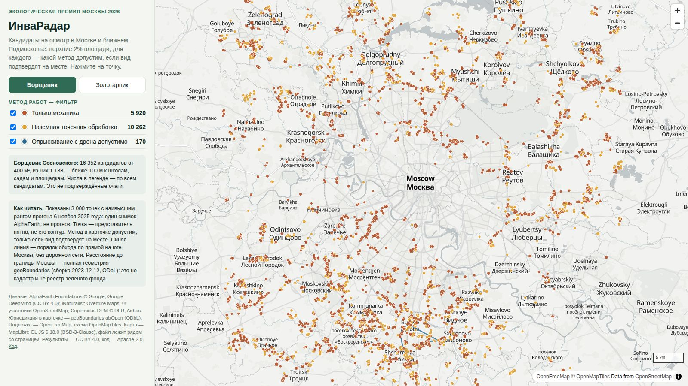
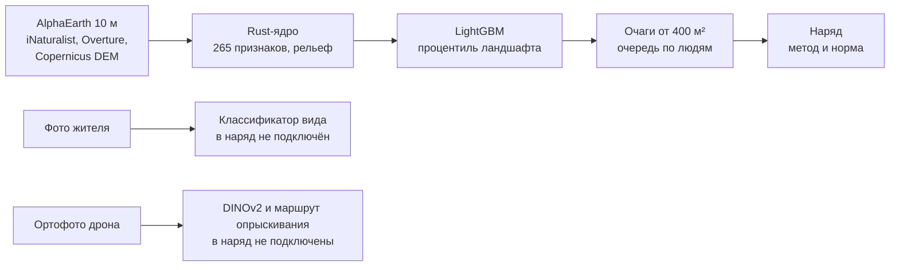

<p align="center">
  <a href="https://konkovdv.github.io/InvaRadar/"></a>
  <a href="presentation/InvaRadar_Ecopremia2026_podacha.pdf"></a>
  <a href="presentation/InvaRadar_Ecopremia2026.pdf"></a>
</p>

<p align="center">
  <a href="https://github.com/KonkovDV/InvaRadar/actions/workflows/ci.yml"></a>
  
  
  <a href="LICENSE"></a>
  <a href="LICENSE-DATA.md"></a>
  
</p>

Русский | [English](README.en.md)

# ИнваРадар

**Задача.** С 1 марта 2026 года 294-ФЗ обязал правообладателей участков бороться с опасными инвазивными растениями. Перечни утверждают регионы. Для Москвы это постановление Правительства Москвы от 03.03.2026 № 369-ПП: в группе I — борщевик Сосновского и золотарники канадский и гигантский ([ГАРАНТ](https://base.garant.ru/413816164/)). Штраф по ч. 2 ст. 8.7 КоАП РФ — 20–50 тыс. ₽ гражданину и 400–700 тыс. ₽ юрлицу; в Москве ещё действует ч. 4 ст. 4.17 КоАП Москвы, суммы по ней нужно сверить с официальным текстом. Сплошной облёт города закрыт: запуск беспилотников ограничен с мая 2023 года.

**Что делает ИнваРадар.** Считает по открытым спутниковым эмбеддингам карту относительного риска (процентиль ландшафта) борщевика Сосновского и двух золотарников с шагом 10 м. Верхние 2% площади от 400 м² ставит в очередь на осмотр. Для каждого такого кандидата готовит проект наряда: какие методы допустимы, если вид подтвердят на месте. Это черновик со статусом `candidate` и пустым полем `signed_by`: подпись человека программа не хранит.

| Звено | Вопрос | ИнваРадар |
|---|---|---|
| Спутник | где вероятнее всего растёт | карта двух видов на 4 225 км², шаг 10 м |
| Очередь | куда ехать первым | ранг × близость людей × близость дорог, рек и ЛЭП × размер; порядок обхода по прямой, без дорожной сети |
| Проверка | борщевик это или дудник | фото жителя → классификатор вида; ортофото дрона → контур куртины |
| **Наряд** | **каким методом здесь можно** | **метод и норма: ВК РФ ст. 65, СанПиН 2.1.3684-21, 73-ФЗ** |
| Контроль | помогло ли | срок повторного осмотра в наряде; снимок после работ замкнёт цикл в сезоне 2027 года |

Проект подготовлен к Экологической премии Москвы 2026, номинация «Цифровизация экологических решений». Коньков Д. В. ([@KonkovDV](https://github.com/KonkovDV)).

## Что уже работает

- **Карта двух видов** на квадрате 65 × 65 км: Москва и ближний пояс области, 42,25 млн пикселей. Ядро на Rust считает её примерно за 2 минуты на 4 ядрах.
- **Проверка на блоках 5 км, которых не было в обучении.** В верхних 10% площади лежат 25,0% известных находок борщевика (95% ДИ 20,7–28,8): в 2,5 раза больше, чем при случайном обходе. У золотарника 32,5%, в 3,3 раза.
- **Проверка на более поздних находках.** Метки для обучения — до 2024 года, проверка — новые находки 2025–2026 годов дальше 100 м от старых. Признаки у обеих сторон — один снимок AlphaEarth за 2025 год, включая среднее в окне 450 м. Это не прогноз по более раннему снимку. В верхние 20% площади попали 38,4% новых находок борщевика (n = 383) и 45,7% золотарника (n = 346).
- **Проект наряда для 38 308 кандидатов на осмотр** (16 056 борщевика и 22 252 золотарника). Порог — процентиль 0,98; после записи в 250 уровней это около 2,2% площади, пятна меньше 400 м² отброшены. Площадь кандидатов борщевика — 9 018,8 га. Доля настоящего борщевика среди них не измерена.
- **Закон проверяется тестами** на 200 первых нарядах каждого вида и на точках веб-карты: в водоохранной зоне, на ООПТ и у детей нет химии, в населённом пункте нет дрона с пестицидом, у памятника нет перекопки.
- **Фото жителей.** Борщевик против дудника, борщевика сибирского, купыря и сныти: точность 86,7%, полнота 86,5%. Золотарник против пижмы, крестовника и зверобоя: 88,7% и 88,7%. При уверенности от 0,9 модель сама закрывает 68,2% сообщений; на этой доле ошибок 6,2%.
- **Дрон на 263 аэрофото Подмосковья** из открытого набора Сколтеха: ROC AUC 0,948 по патчам 14 × 14, когда снимавшая камера не участвовала в обучении. У авторов набора 0,96 по другому протоколу (Menshchikov et al., 2021): числа рядом, но не вместо друг друга. У набора на GitHub нет лицензии, снимки в репозиторий не входят.
- **Инференс на Rust совпадает с LightGBM**: наибольшая разница 8,9·10⁻¹⁶ на 2 000 точках пайплайна (`rust_parity_max_abs_diff`). Тест одного узла с NaN это число не считает.



<sub>Процентиль ландшафта, 2025. Тёмные пятна — верхние проценты площади, куда осмотр едет первым.</sub>

## Содержание

- [С чего начать](#с-чего-начать)
- [Цифры](#цифры)
- [Как устроено](#как-устроено)
- [Закон в наряде](#закон-в-наряде)
- [Откуда взяты решения](#откуда-взяты-решения)
- [Сравнение с аналогами](#сравнение-с-аналогами)
- [Границы версии 1.2](#границы-версии-12)
- [Трудные вопросы](#трудные-вопросы)
- [Запуск](#запуск)
- [Структура и стек](#структура-и-стек)
- [Документы](#документы)
- [Цитирование и лицензии](#цитирование-и-лицензии)

## С чего начать

Карта 3 000 приоритетных очагов каждого вида, с методом и нормой по клику: [konkovdv.github.io/InvaRadar](https://konkovdv.github.io/InvaRadar/).

[](https://konkovdv.github.io/InvaRadar/)

<sub>Ржавый — только механика, янтарный — наземная точечная обработка, синий — опрыскивание с дрона допустимо. Подложка © участники OpenStreetMap.</sub>

| Вы | Смотрите |
|---|---|
| Член жюри | [презентацию для подачи](presentation/InvaRadar_Ecopremia2026_podacha.pdf), карту, разделы «Цифры» и «Границы» ниже |
| Ботаник, эколог | [научное обоснование](docs/SCIENCE.md), [карточку модели](docs/MODEL_CARD.md), [журнал экспериментов](docs/EXPERIMENTS.md) |
| Юрист, надзор | [право в наряде](docs/SCIENCE.md#7-право), `invaradar/management.py`, `tests/test_legal_invariants.py` |
| ГИС-специалист | [карточку данных](docs/DATA_CARD.md), каталог `stac/`, `make release` |
| Разработчик | [архитектуру](docs/ARCHITECTURE.md), [правила участия](CONTRIBUTING.md), `Makefile` |

## Цифры

Квадрат 65 × 65 км, 4 225 км², шаг 10 м. Внутри Москва и ближний пояс области, дальний ТиНАО в квадрат не входит. Все числа лежат в `outputs/heracleum/`, `outputs/solidago/`, `outputs/photo/` и `outputs/drone/`.

| | Борщевик | Золотарник |
|---|---|---|
| Находки в верхних 10% площади на блоках 5 км вне обучения | **25,0%** (95% ДИ 20,7–28,8), в 2,5 раза больше случайного обхода | **32,5%** (28,4–35,9), в 3,3 раза |
| Находки в верхнем 1% площади | 2,5% (1,3–3,7) | **7,1%** (5,1–8,8), в 7 раз |
| Новые находки 2025–2026 гг. в верхних 20%, обучение до 2024 г. | 38,4% (33,7–43,3), n = 383 | 45,7% (40,5–50,9), n = 346 |
| ROC AUC против фона, те же блоки | 0,686 | 0,690 |
| Площадь в области применимости модели | 96,3% | 95,7% |
| Кандидаты на осмотр от 400 м² / в 300 м от школ, садов и площадок | 16 056 / 4 309 | 22 252 / 6 995 |
| Опрыскивание с дрона / наземная обработка / только механика | 168 / 10 367 / 5 521 | 171 / 14 675 / 7 406 |

Интервалы пространственной проверки — кластерный бутстрэп по блокам 5 км, 2000 повторов; теста во времени — интервал Уилсона. Случайный обход находит долю находок, равную доле пройденной площади: 10% площади дают 10% находок.

Метки — точки жителей с погрешностью координат до 50 м, часто растение меньше пикселя. Поэтому мера качества здесь — доля известных точек в верхней части карты, а не совпадение контуров. Точки борщевика, рядом с которыми в 30 м есть второй наблюдатель research grade, в верхних 10% дают 39,8% (n = 133). Это отдельный прогон `scripts/exp_labels.py`: 3 фолда, 150 деревьев, `learning_rate` 0,08. Не основная модель с 5 фолдами и 300 деревьями. Выборка уже прошла `build()`, комментарий скрипта не обещает все градации iNaturalist. Число лежит в `outputs/heracleum/exp_labels.json`.

Модуль БПЛА, 263 аэрофото: в режиме разведки (порог max F2 снят с двух других камер) Dice 0,71, борщевик найден на 216 из 251 снимков, отдельные куртины — в 60% случаев. Для подсчёта площади порог max F1 даёт Dice 0,66. По камерам и протокол — [журнал экспериментов](docs/EXPERIMENTS.md).

<sub>Снимки набора Сколтеха в репозиторий не входят: на GitHub у набора нет лицензии. Числа проверки — в `outputs/drone/benchmark.json`.</sub>

## Как устроено



1. **Признаки.** 64 измерения эмбеддинга AlphaEarth Foundations на пикселе 10 м и средние в окнах 50, 150 и 450 м. Логарифм расстояния до магистралей, второстепенных дорог, железных дорог, воды и ЛЭП. Рельеф: заполнение впадин Priority-Flood, сток D8, TWI и HAND. Всего 265 признаков.
2. **Модель.** LightGBM, находка против фона. Фон — 60 000 наблюдений других сосудистых растений любыми наблюдателями в той же зоне. Это снижает смещение к дорогам и паркам, но не убирает его.
3. **Проверка.** Блоки 5 × 5 км без буфера: окно 450 м может задеть соседний блок. Отдельный разрез — по году метки на одном снимке 2025 года, см. абзац выше. Область применимости по методу Meyer & Pebesma. Полевая выборка из 250 точек по четырём слоям ранга. Обхода не было.
4. **Очередь.** Связные зоны верхних 2% площади от 400 м². Три ранга пишутся отдельными колонками: у детей размер не влияет, для сдерживания важнее малый изолированный очаг, массивы от 1 га идут отдельной программой. Прямая ломаная первых точек идёт по общему баллу `priority`, в котором размер по-прежнему есть. Дорожной сети нет.
5. **Наряд.** Правила закона из `invaradar/management.py`, у каждого правила своя норма. Статус черновика — `candidate`, поле `signed_by` пустое: программа подпись не хранит. Постановление 369-ПП попадает в текст, только если передан полигон юрисдикции. Опубликованный прогон такой полигон не передавал. Классификатор фото и модуль БПЛА в наряд не пишут.
6. **Из КОЗ-3** ([expds-koz3](https://github.com/KonkovDV/expds-koz3)). Датчики не усредняются. Уверенность кадра — ранг внутри этого кадра, не общий порог на все снимки. Порог качества снимается с других групп, не с той, которую потом показывают. Локальный рельеф — высота минус среднее в окне, без отмывки. Это функции `invaradar/survey_protocol.py`. В 265 признаков карты они не входят, и опубликованные доли захвата ими не менялись. Код конкурента EXpedition не копируется.

Рельеф оставлен у борщевика и выключен у золотарника. Критерий был задан до сравнения: доля новых находок в верхних 20%. У борщевика она выросла с 36,0% до 38,4%, у золотарника с рельефом упала с 45,7% до 43,4%. Борщевик держится сырых обочин, брошенных полей и берегов; золотарнику на залежах важнее заброшенность, чем сток.

Метки борщевика взяты по трём таксонам iNaturalist: *H. sosnowskyi*, *H. mantegazzianum* и комплекс гигантских борщевиков. В Средней России два последних почти всегда тот же Сосновский, подписанный иначе. Золотарники — *Solidago canadensis* и *S. gigantea*: в городе растут оба, и бригада убирает оба.

Схема модулей и файлов — [архитектура](docs/ARCHITECTURE.md).

## Закон в наряде

Редакции на 30.10.2026: Водный кодекс в ред. от 04.08.2026, СанПиН 2.1.3684-21 с изменениями от 12.02.2026 (действуют с 10.03.2026).

| Правило | Норма | Очагов борщевика |
|---|---|---|
| Водоохранная зона 50, 100 или 200 м по длине реки: пестициды запрещены, только механика | ВК РФ ст. 65, ч. 4–6 и ч. 15 п. 3, 6 | 4 456 |
| Населённый пункт: только наземная аппаратура; беспилотник с пестицидом — не ближе 700 м от жилья, вод и ООПТ | СанПиН 2.1.3684-21, п. 273 и 282 | 10 367 — наземно |
| Территория детской организации: пестициды запрещены | СанПиН 2.1.3684-21, п. 273 | 105 |
| Школа, сад или площадка в 100 м: без пестицидов; отдельный ранг безопасности, не порядок объезда | правило осторожности системы, отдельной нормы с этим расстоянием нет | 1 227 |
| ООПТ и парки: механические методы | режимы ООПТ, практика Мосприроды | 727 |
| Объект наследия в 50 м: без перекопки | правило осторожности; ст. 36 73-ФЗ требует согласования земляных работ, расстояния 50 м в законе нет | 74 |
| Наземная химия: оповещение за 5 дней и знаки. В населённом пункте ещё часы до 7:00 или после 22:00 | СанПиН 2.1.3684-21, п. 272 и п. 273 | в нарядах с наземной химией, не в механических |

Итог по борщевику: только механика — 5 521 очаг, наземная точечная обработка — 10 367, опрыскивание с дрона допустимо — 168, все вне населённых пунктов. По золотарнику — 7 406, 14 675 и 171. Канал не получает ширину реки: ст. 65 ч. 9 отдаёт её полосе отвода, а полосы в данных нет. Постановление 369-ПП пишется в наряд только вместе с полигоном Москвы; в опубликованных таблицах этого полигона не было.

Биология в наряде: зонтики срезают до конца июля и повторно в августе, вывозят в мешках. Куртины больше 0,5 га косят не реже раза в 2 недели с мая по сентябрь. Корневую шейку подрезают на 5–10 см там, где нет запрета на земляные работы. И борщевик, и золотарник наблюдают 5 сезонов. В каждом наряде по борщевику указаны СИЗ.

## Откуда взяты решения

| Наблюдение | Решение в ИнваРадаре |
|---|---|
| Находки граждан сгущаются у дорог и в парках. Фон из наблюдений других растений в той же зоне снижает это смещение, но не убирает его (Phillips et al., 2009) | фон — 60 000 наблюдений других растений любыми наблюдателями |
| Случайное разбиение завышает качество пространственной модели (Roberts et al., 2017) | блоки 5 × 5 км и проверка на следующих годах |
| Карте нельзя верить там, где признаки далеки от обучающих (Meyer & Pebesma, 2021) | индекс несходства; вне области применимости 3,7% площади у борщевика |
| Площадь и точность карты оценивают по стратифицированной случайной выборке (Olofsson et al., 2014) | 250 точек по четырём слоям ранга; обхода не было |
| Без заполнения впадин сток рвётся в каждой ямке (Barnes et al., 2014); HAND меряет превышение над водотоком вдоль стока (Rennó et al., 2008) | Priority-Flood, D8, TWI и HAND в ядре на Rust |
| Открытые годовые эмбеддинги 10 м описывают каждый пиксель без своей разметки снимков (AlphaEarth Foundations, 2025) | 64 измерения пикселя и средние в трёх окнах |
| Замороженный DINOv2 переносится на новую задачу линейным зондом (Oquab et al., 2024) | библиотека БПЛА: зонд по патчу 14 × 14 и окрестности 3 × 3. В проект наряда не входит |
| Одиночное растение меньше пикселя Sentinel-2 | спутник сужает поиск, контур даёт дрон |

Полный список литературы — [источники](docs/SOURCES.md).

## Сравнение с аналогами

| Решение | Что делает | Число из открытого источника | Связь с ИнваРадаром |
|---|---|---|---|
| Сколтех, Menshchikov et al., 2021 | сегментация борщевика на борту дрона, Jetson Nano | ROC AUC 0,96 | на их наборе модуль БПЛА даёт 0,948, когда камера снимка не участвует в обучении |
| Яндекс, ШАД и «СтопБорщевик», 2026 | попиксельный CatBoost по RGB и индексу CIVE, не нейросеть | 421 га в 17 регионах; IoU 0,7 в блоге и 0,75 на Habr | метки внутри экспертных полигонов частично получены тем же порогом CIVE, поэтому IoU завышен по построению. Москва и область размечены целиком: это независимая проверка карты, для неё нужно разрешение |
| Минсельхоз Московской области, 2026 | ДЗЗ, дрон, кадастр, штраф | первый штраф 150 тыс. ₽, Рузский округ | та же цепочка, но к приоритету по детям и методу по закону |
| «Инвазиум», ГБС РАН | фото через чат-бот, проверка ботаниками | — | классификатор снимает с ботаника сообщения, где модель уверена |
| SDM борщевика для Литвы | модель пригодности | сетка 1 км | шаг 10 м и проверка на новых территориях и годах |

ИнваРадар считает карту, очередь осмотра и проект наряда. У Департамента природопользования уже есть свой контур: адресный перечень, данные дистанционного зондирования и камеры. ИнваРадар — дополнение к нему, а не замена. Обзор открытого кода и моделей 2025–2026 годов — [аналоги](docs/LANDSCAPE.md).

## Границы версии 1.2

| Область | Сейчас | Следующий шаг |
|---|---|---|
| Полевая проверка | 250 точек выбраны, обхода не было; площади зарослей по земле в таблицах нет | обход в пилоте 2027 года |
| Водоохранные зоны | длина реки и ручья внутри квадрата — нижняя оценка. Канал по ст. 65 ч. 9 не получает речную ширину: полосы отвода нет. Канава — 50 м как осторожность. Опубликованные очереди — 30.10.2026. Зон санитарной охраны в слое нет | границы из Государственного водного реестра, полосы каналов и слой ЗСО; пересчёт `make requeue` |
| ООПТ | парки, памятники природы и заповедники из Overture | официальный слой ООПТ |
| Дрон | 263 весенних кадра Сколтеха: листья и розетки | летние облёты Москвы по госзаданию, индекс цветения |
| Контроль | срок повторного осмотра в наряде | снимок после работ, итог — разметка сезона |
| Фото жителей | YOLO11s-cls, веса под AGPL-3.0 в репозиторий не входят | BioCLIP 2 под MIT |
| Рельеф | Copernicus DEM включает здания и кроны | городская модель рельефа без зданий |
| Сплошные карты 10 м | `make release` собирает их в `dist/release/` | релиз на GitHub |

## Трудные вопросы

| Вопрос | Короткий ответ | Где подробно |
|---|---|---|
| 25% — это мало? | Это доля известных точек в 10% площади на районах, которых модель не видела: в 2,5 раза больше случайного обхода. У устойчивых точек — 39,8% | [карточка модели](docs/MODEL_CARD.md) |
| ROC AUC 0,69 — слабая модель? | AUC меряет разделение находки и фона по всей площади. Метки — точки с погрешностью до 50 м, а среди фоновых точек есть ненайденный борщевик. Бригаде важен верх очереди, там находок в 2,5–3,3 раза больше | [журнал экспериментов](docs/EXPERIMENTS.md) |
| Можно ли в Москве опрыскивать с дрона? | В населённом пункте только наземная аппаратура, беспилотник с пестицидом — не ближе 700 м от жилья, вод и ООПТ. В расчёте это 168 и 171 очаг, все вне населённых пунктов | [право](docs/SCIENCE.md#7-право) |
| ИИ назначает штраф? | Нет. Карта — индикатор риска, наряд подписывает человек, протокол по ст. 8.7 КоАП составляет инспектор | [карточка модели](docs/MODEL_CARD.md) |
| Почему рельеф только у борщевика? | Критерий задан до сравнения. У борщевика рельеф поднял долю новых находок, у золотарника опустил | [журнал экспериментов](docs/EXPERIMENTS.md) |
| Зачем в борщевике *H. mantegazzianum*? | В Средней России под этим именем на iNaturalist почти всегда Сосновский. Без этих точек пропали бы настоящие очаги | [карточка модели](docs/MODEL_CARD.md) |
| Что если AlphaEarth станет недоступен? | Эмбеддинги приходят через один интерфейс; TESSERA и OlmoEarth дают такие же глобальные слои 10 м. В версии 1.2 замена не прогнана | [аналоги](docs/LANDSCAPE.md) |
| Чьи фото на слайдах и в обучении? | iNaturalist под CC BY и CC0, авторы — в `presentation/assets/CREDITS.csv`. Набор Сколтеха без указанной лицензии используется только для оценки и не распространяется | [NOTICE](NOTICE) |
| Персональные данные? | В модели только координаты растений. Бот и API не должны хранить лица, номера машин и геометки жилых адресов (152-ФЗ) | [безопасность](SECURITY.md) |
| Зачем Rust? | 42 млн пикселей × 265 признаков за один проход: карта примерно за 2 минуты на 4 ядрах, рельеф кешируется | [архитектура](docs/ARCHITECTURE.md) |

## Запуск

Нужны Python 3.11+ и Rust. Полный прогон скачивает около 9 ГБ открытых данных: блоки AlphaEarth, наблюдения iNaturalist, Overture, Copernicus DEM.

```bash
git clone https://github.com/KonkovDV/InvaRadar && cd InvaRadar
pip install -e ".[dev]"
make core test    # 6 тестов Rust и 40 тестов Python, из них 12 — закон на нарядах и карте
make all          # данные, обе модели, варианты рельефа, интервалы, рисунки
```

Без make, в том числе на Windows: `cargo test --release` в `core-rs`, затем `python -m pytest` в корне. Ядро на Windows называется `invaradar_core.exe`.

| Команда | Что делает |
|---|---|
| `make requeue` | пересчитывает очереди и наряды после правки правил или слоёв, без нового обучения |
| `make drone` | проверка модуля БПЛА на наборе Сколтеха (`pip install -e ".[drone]"`, набор рядом с репозиторием) |
| `make release` | сплошные карты 10 м (COG), GeoParquet очагов, каталог STAC и `SHA256SUMS` в `dist/release/` |
| `make deck` | обе презентации из `outputs/*.json` |

Папки данных задаются переменными `INVARADAR_DATA`, `INVARADAR_CACHE` и `INVARADAR_OUT`. Docker: `docker build -t invaradar .`

## Структура и стек

```
core-rs/        ядро на Rust: признаки, рельеф, инференс, очаги, маршрут, выборка
invaradar/      пакет Python: данные, приоритет, правила закона, модуль БПЛА
scripts/        пайплайн, область применимости, интервалы, карты, классификатор фото
tests/          закон на нарядах, водоохранные зоны, приоритет, деквантование, БПЛА, ядро
outputs/        метрики, интервалы, очереди, 200 нарядов, полевая выборка, рисунки
web/            веб-карта на MapLibre GL
stac/           каталог STAC 1.1 для сплошных карт
presentation/   презентации, генераторы, шрифты, фото
docs/           наука, эксперименты, карточки модели и данных, аналоги, план, источники
```

- **Rust 2024**: `rayon`, `memmap2`, `serde_json`, `anyhow`. Один многопоточный проход по мозаике без копирования.
- **Python**: LightGBM, scikit-learn, GeoPandas, Shapely, rasterio, pyproj, PyArrow. Модуль БПЛА: PyTorch и timm (`.[drone]`). Классификатор фото: Ultralytics (`.[photo]`).
- **Форматы**: Cloud Optimized GeoTIFF, GeoParquet, STAC 1.1.
- **Веб-карта**: MapLibre GL, подложка OpenStreetMap, публикация через GitHub Pages.
- **CI**: `cargo fmt`, `clippy -D warnings`, `cargo test`, `ruff`, `pytest` на Python 3.11, 3.12 и 3.13.

## Документы

| Документ | Содержание |
|---|---|
| [Научное обоснование](docs/SCIENCE.md) | биология видов, физика пикселя, гидрология, право, наследие |
| [Журнал экспериментов](docs/EXPERIMENTS.md) | что сравнивали, по какому критерию, что оставили |
| [Карточка модели](docs/MODEL_CARD.md) | признаки, обучение, проверка, границы, этика |
| [Карточка данных](docs/DATA_CARD.md) | поля очага и наряда, файлы, происхождение, чтение растра |
| [Архитектура](docs/ARCHITECTURE.md) | схема, модули, почему Rust и Python |
| [Аналоги](docs/LANDSCAPE.md) | решения в России и мире, открытый код, модели 2025–2026 |
| [План](docs/PLAN.md) | сезон 2027, KPI, команда, бюджет, риски |
| [Источники](docs/SOURCES.md) | литература, нормы, данные |
| [Презентации](presentation/README.md) | файлы, дизайн, пересборка |
| [Изменения](CHANGELOG.md) | версии 0.1–1.2 |

## Цитирование и лицензии

GitHub показывает кнопку «Cite this repository» по [CITATION.cff](CITATION.cff).

```bibtex
@software{konkov_invaradar_2026,
  author  = {Konkov, Dmitrij V.},
  title   = {InvaRadar: early detection of invasive plants from satellite embeddings, drones and citizen photos},
  version = {1.2.0},
  year    = {2026},
  url     = {https://github.com/KonkovDV/InvaRadar},
  license = {Apache-2.0}
}
```

Код — [Apache-2.0](LICENSE). Карты, очаги, наряды и метрики — [CC BY 4.0](LICENSE-DATA.md). «The AlphaEarth Foundations Satellite Embedding dataset is produced by Google and Google DeepMind.» Наблюдения © авторы iNaturalist. © участники OpenStreetMap, Overture Maps Foundation. Copernicus DEM © DLR e.V., Airbus. Полный список — [NOTICE](NOTICE).

Как помочь проекту — [CONTRIBUTING.md](CONTRIBUTING.md). Об уязвимостях — [SECURITY.md](SECURITY.md).
