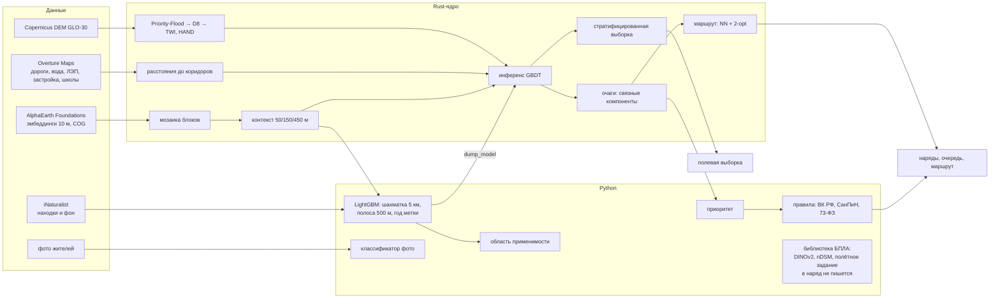

# Архитектура

## Почему так

- **Rust для всего, что касается каждого пикселя.** 42,25 млн пикселей × 265 признаков: признаки, рельеф и инференс считаются в одном многопоточном проходе (rayon). Сверка с LightGBM и сама карта — команда `scoremap`: контекст строится один раз. Пять коридоров читаются параллельно, порядок признаков тот же. Последний замер сплошной карты — около 2 минут на 4 vCPU после того, как мозаика уже в кэше. Этот замер сделан до `kernel.rs` и заново не снимался.
- **Сложение 64 каналов не меняет биты.** Каналы эмбеддинга независимы, поэтому их можно складывать векторно в том же порядке, что и скалярный цикл. `core-rs/src/kernel.rs` делает это командами AVX-512, если процессор их имеет, иначе AVX2, иначе скаляром. Деление — обычное деление IEEE, не умножение на обратное. Порог дерева остаётся f64. Перевод признака из f32 в f64 на конечных числах совпадает с `as f64`. Быстрой математики нет. Priority-Flood, D8, евклидово расстояние и байт очага 245 этот путь не переставляет. Два теста сверяют векторный код со скалярным побитово; обход пропусков LightGBM проверяется отдельно. Расхождение 1,1 · 10⁻¹⁵ на 2 000 точках — прогон 6 ноября, тем же протоколом ядро заново не сверялось.
- **Как это сидит в кэше.** Строка мозаики — 6500 × 64 байт, одна строка кэша на пиксель. Пять строк окна 50 м — около 2 МиБ, объём L2 одного ядра Emerald Rapids. Потоки закрепляются по одному на ядро (`sched_setaffinity`) и каждый считает свою полосу строк, а не перехватывает чужие строки. Узел дерева — 16 байт: порог f64 и индексы u16; лист помечен `u16::MAX`. Сумма столбца выделяется один раз на полосу: раньше каждая из 6500 строк заново брала буфер около 1,6 МиБ. Массивы крупнее 2 МиБ просят большие страницы (`MADV_HUGEPAGE`). На полосе 512 × 6500 этой машины (4 ядра Emerald Rapids, release, `target-cpu=native`) грубое окно и окно 450 м заняли около 0,04–0,06 с и у скалярного цикла, и у явного AVX-512: при `target-cpu=native` компилятор векторизует и скаляр. Это не замер карты 6500 × 6500. Локальная сборка — `target-cpu=native`. В CI `RUSTFLAGS` заменён на `x86-64-v3`, и там остаётся путь AVX2. Минимальная версия Rust — 1.89: встроенные команды AVX-512 стабильны с неё. AMX этой карте не нужен: бустинг не считает матрицы.
- **Один код признаков для обучения и карты.** Точечные признаки и признаки карты считаются одной функцией ядра, а инференс сверяется с LightGBM на 2000 точек при каждом прогоне.
- **Python для статистики и права.** Перекрёстная проверка, интервалы, область применимости, правила обработки и картография — там, где важна читаемость и экосистема (geopandas, scikit-learn, LightGBM).
- **Облачные форматы.** Растры — Cloud Optimized GeoTIFF, векторы — GeoParquet, каталог — STAC 1.1: данные читаются по HTTP частями.

## Модули

| Путь | Назначение |
|---|---|
| `core-rs/src/main.rs` | команды `points`, `predict`, `score`, `scoremap`, `hotspots`, `route`, `strata`; чтение кэша float — одним проходом; 9 тестов команд и численных правил и один замер полосы, который CI не запускает |
| `core-rs/src/kernel.rs` | сложение 64 каналов, деквантование и перевод в f64: AVX-512, AVX2 или скаляр, одни и те же биты; 2 теста побитового совпадения |
| `invaradar/aef.py` | индекс тайлов AlphaEarth, кэш блоков 1024 × 1024 × 64, деквантование |
| `invaradar/samples.py` | находки и фон из iNaturalist |
| `invaradar/splits.py` | шахматка 5 км, полоса 500 м только вокруг проверочных находок, разрез по году, индекс Бойса, процентиль ландшафта |
| `invaradar/legal.py` | перечни: 369-ПП только для сверенной юрисдикции, перечень области не подставляет обязанность |
| `invaradar/layers.py` | общие слои: детские объекты и населённые пункты — одни для очереди и для нарядов |
| `invaradar/priority.py` | приоритет очагов |
| `invaradar/queue.py` | кандидаты на осмотр → очередь, порядок обхода по прямой (общий код `pipeline.py` и `requeue.py`) |
| `invaradar/management.py` | водоохранные зоны и рецепты; подрезка 10–15 см; один классификатор метода для сводки и веб-карты; канава — 50 м, не полоса 700 м |
| `invaradar/jurisdictions.py`, `boundaries/jurisdictions.geojson` | полигоны Москвы и области для колонки `jurisdiction` |
| `invaradar/photo_license.py` | в коммерческую модель фото входят только CC0 и CC BY |
| `pro/` | ИнваРадар Pro: закон в YAML, журнал RFC 9162, доказательства, закрытие очага, демо |
| `invaradar/survey_protocol.py` | локальный рельеф и порог, снятый с других групп; в 265 признаков карты не входит |
| `invaradar/inat_api.py` | сообщения жителей в окне карты через API iNaturalist, если выгрузки нет на диске |
| `invaradar/drone.py` | библиотека: DINOv2, индекс цветения, TorchScript, фильтр nDSM, полигоны, полётное задание. Пайплайн наряда её не вызывает |
| `scripts/drone_benchmark.py` | проверка модуля БПЛА на 263 реальных аэрофото, камера исключается из обучения |
| `invaradar/style.py` | палитра и шрифты рисунков |
| `scripts/fetch_aef_index.py`, `fetch_inat.py`, `fetch_dem.py`, `fetch_overture.py`, `prefetch_aef.py`, `prep_dem.py` | загрузка и подготовка открытых данных |
| `scripts/pipeline.py` | полный прогон вида |
| `scripts/enrich.py` | область применимости, полевая выборка |
| `scripts/prescribe.py` | наряды: метод работ и правовое основание для каждого очага |
| `scripts/requeue.py` | пересчёт очереди и маршрута из готовых очагов без переобучения; `make requeue` после него пишет наряды и веб-карту |
| `scripts/export_web.py` | веб-карта: верхние очаги и сводка, те же классы методов, что в нарядах |
| `invaradar/model.py` | один лес для карты и для доверительных интервалов |
| `scripts/make_release.py` | ассеты релиза, каталог STAC, SHA256SUMS |
| `scripts/uncertainty.py` | доверительные интервалы; ранги из `oof_rank.f64`, если их записал тот же прогон |
| `scripts/render_maps.py`, `scripts/render_figures.py` | карты и научные рисунки |
| `scripts/train_photo_verifier.py` | классификатор фото |
| `presentation/build_submission.js` | презентация для подачи: 10 страниц A4 по Положению о премии |
| `presentation/build_deck.js` | полная презентация PowerPoint из `outputs/*.json` |
