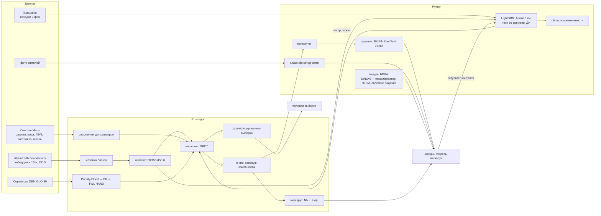

# Архитектура

## Почему так

- **Rust для всего, что касается каждого пикселя.** 42,25 млн пикселей × 265 признаков: признаки, рельеф и инференс считаются в одном многопоточном проходе (rayon), без копирования мозаики. Карта — около 2 минут на 4 vCPU.
- **Один код признаков для обучения и карты.** Точечные признаки и признаки карты считаются одной функцией ядра, а инференс сверяется с LightGBM на 2000 точек при каждом прогоне.
- **Python для статистики и права.** Перекрёстная проверка, интервалы, область применимости, правила обработки и картография — там, где важна читаемость и экосистема (geopandas, scikit-learn, LightGBM).
- **Облачные форматы.** Растры — Cloud Optimized GeoTIFF, векторы — GeoParquet, каталог — STAC 1.1: данные читаются по HTTP частями.

## Модули

| Путь | Назначение |
|---|---|
| `core-rs/src/main.rs` | команды `points`, `predict`, `score`, `hotspots`, `route`, `strata`; 6 модульных тестов |
| `invaradar/aef.py` | индекс тайлов AlphaEarth, кэш блоков 1024 × 1024 × 64, деквантование |
| `invaradar/samples.py` | находки и фон из iNaturalist |
| `invaradar/layers.py` | общие слои: детские объекты и населённые пункты — одни для очереди и для нарядов |
| `invaradar/priority.py` | приоритет очагов |
| `invaradar/queue.py` | очаги → очередь, маршрут дня (общий код `pipeline.py` и `requeue.py`) |
| `invaradar/management.py` | водоохранные зоны и рецепты работ по ВК РФ, СанПиН 2.1.3684-21 и 73-ФЗ; длина реки по сети водотоков |
| `invaradar/inat_api.py` | сообщения жителей в окне карты через API iNaturalist, если выгрузки нет на диске |
| `invaradar/drone.py` | сегментация ортофотоплана (DINOv2 + линейный классификатор, индекс цветения, TorchScript), фильтр nDSM, полигоны, полётное задание |
| `scripts/drone_benchmark.py` | проверка модуля БПЛА на 263 реальных аэрофото, камера исключается из обучения |
| `invaradar/style.py` | палитра и шрифты рисунков |
| `scripts/fetch_aef_index.py`, `fetch_inat.py`, `fetch_dem.py`, `fetch_overture.py`, `prefetch_aef.py`, `prep_dem.py` | загрузка и подготовка открытых данных |
| `scripts/pipeline.py` | полный прогон вида |
| `scripts/enrich.py` | область применимости, полевая выборка |
| `scripts/prescribe.py` | наряды: метод работ и правовое основание для каждого очага |
| `scripts/requeue.py` | пересчёт очереди и маршрута из готовых очагов без переобучения |
| `scripts/make_release.py` | ассеты релиза, каталог STAC, SHA256SUMS |
| `scripts/uncertainty.py` | доверительные интервалы |
| `scripts/render_maps.py`, `scripts/render_figures.py` | карты и научные рисунки |
| `scripts/train_photo_verifier.py` | классификатор фото |
| `presentation/build_submission.js` | презентация для подачи: 10 страниц A4 по Положению о премии |
| `presentation/build_deck.js` | полная презентация PowerPoint из `outputs/*.json` |
