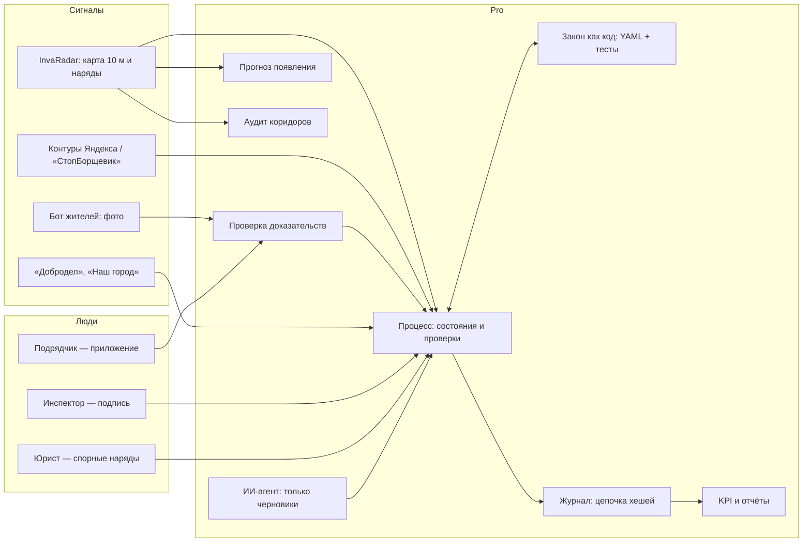
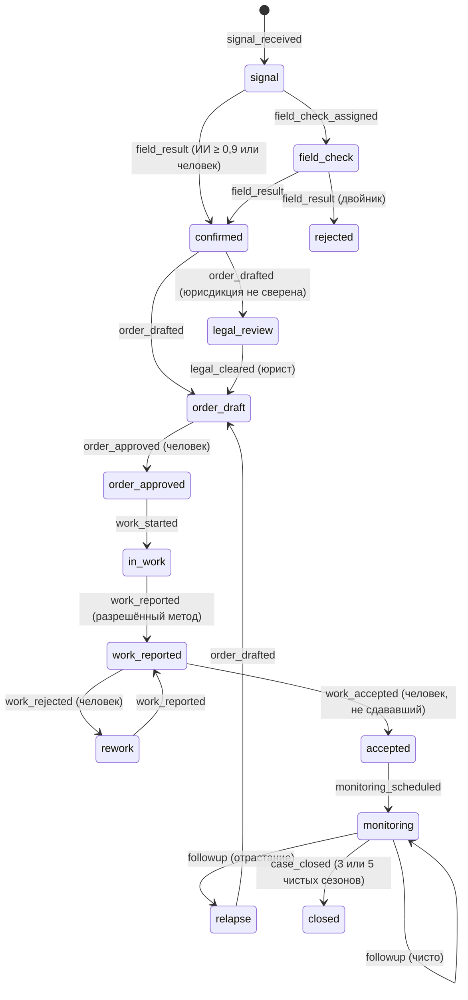

# Архитектура

## 1. Поток данных

## 2. Состояния очага

Отказ на любом шаге пишется в журнал событием `blocked_attempt`: кто, что пытался сделать и почему нельзя.

## 3. Модель данных

| Сущность | Поля | Хранение |
|---|---|---|
| Event | seq, case_id, type, actor {id, role, kind}, at, payload, prev_hash, hash | JSONL сейчас; в промышленной версии — PostgreSQL, только вставка, запрет UPDATE и DELETE триггером |
| Case | Пересобирается из событий: состояние, решение, наряд, подрядчик, вердикт доказательств, чистые сезоны | Кэш снимков |
| Decision | allowed, recommended, prohibited {метод: правила}, requirements, obligations, citations, flags, requires_legal_review | В payload событий `order_drafted` и `legal_cleared` |
| Evidence | sha256 исходника, координаты, время, dHash, проверки, вердикт | В payload; файл — в объектном хранилище, копия без метаданных |

## 4. Почему так

- **Событийная модель вместо таблицы статусов.** Журнал — единственный источник правды. Состояние можно пересобрать на любую дату («что знал инспектор 12 июня?»). При пересборке каждый переход проверяется заново, поэтому подменённый и пересчитанный журнал тоже ловится (тест `test_replay_rejects_forged_but_rehashed_log`).
- **Закон в YAML, а не в коде.**
  - Юрист читает и правит правила без программиста.
  - Тесты инвариантов ловят ослабление запретов.
  - Пакет юрисдикции подключается файлом.
- **Человек в контуре — на уровне ядра, а не интерфейса.** Запрет на подпись агентом стоит в `workflow.py`, поэтому его не обойти ни через API, ни через промпт.
- **Только numpy, PyYAML и Pillow в ядре.** Ставится в закрытом контуре без интернета. FastAPI — необязательный слой.

## 5. Развёртывание

| Вариант | Для кого | Что внутри |
|---|---|---|
| Облако в РФ (Yandex Cloud) | Пилоты, округа | Контейнер API, PostgreSQL, объектное хранилище, бот |
| Контур заказчика | Регион, Москва | Те же контейнеры; сборка под Astra Linux и РЕД ОС; без доступа в интернет — данные спутника загружаются пакетом |
| Ноутбук | Демо и офлайн-проверка | `make demo` — 2 секунды, без сети |

## 6. Безопасность

- **Вход.** Роли берутся из токена (OIDC; для госслужащих — ЕСИА); заголовки `X-Actor-*` в `api.py` — только для демо.
- **Целостность журнала.** Цепочка хешей. Голова цепочки раз в сутки подписывается УКЭП или получает метку времени TSP.
- **Персональные данные (152-ФЗ):**
  - первичный сбор и хранение данных граждан РФ — в базах на территории РФ (ст. 18 ч. 5);
  - метаданные фото удаляются из копий (`strip_metadata`), в журнал пишется только SHA-256;
  - согласие жителя берётся в боте.
- **ГИС.** При интеграции с государственными информационными системами действует приказ ФСТЭК № 117 (с 01.03.2026, заменил приказ № 17): модель угроз и класс защищённости определяет оператор ГИС.
- **ИИ-агент:**
  - российская LLM в контуре заказчика или в облаке в РФ;
  - персональные данные в зарубежные модели не передаются;
  - инструменты, которые что-то меняют, требуют подписи человека (`agent_tools.py`).

## 7. Интеграции

| Система | Что берём или отдаём | Как |
|---|---|---|
| InvaRadar | Кандидаты, флаги закона, ранг | CSV и GeoParquet (`upstream.py`) |
| Яндекс / «СтопБорщевик» | Контуры очагов | GeoJSON, по соглашению |
| «Добродел», «Наш город» | Обращения → сигналы; статус → обратно | API заказчика |
| «Инвазиум» (ГБС РАН) | Проверка спорных фото ботаниками; данные для обучения | Соглашение |
| Росреестр | Кадастровый номер участка — по координатам. Сведения о правообладателе запрашивает уполномоченный орган | Через заказчика |
| Геопортал Роскосмоса | Резерв спутниковых данных («Ресурс-П», «Канопус-В») | По договору |

## 8. Журнал прозрачности и происхождение снимков (v0.2)

- **Два уровня целостности:**
  - цепочка хешей (`events.py`) — для оператора;
  - дерево Меркла по RFC 9162 (`merkle.py`) — для третьих сторон.
- **Что можно проверить, не видя всего журнала:**
  - подрядчик проверяет включение своей приёмки по 8–10 хешам;
  - заказчик проверяет, что вчерашний подписанный корень — префикс сегодняшнего журнала (согласованность).
- **Голова дерева** (размер, корень, время) подписывается раз в сутки. В демо — HMAC, в эксплуатации — УКЭП по ГОСТ Р 34.10-2012 или метка времени TSP аккредитованного центра.
- **Команда:** `invaradar-pro prove out_demo/events.jsonl --seq N` — доказательство включения события N.
- **Снимки.**
  - Основной путь — съёмка в приложении: время и место от сервера, одноразовый код наряда в кадре.
  - Если на снимке есть C2PA Content Credentials (Pixel 10 подписывает каждый JPEG), он принимается как сильное доказательство. Отсутствие C2PA не считается признаком подделки.
